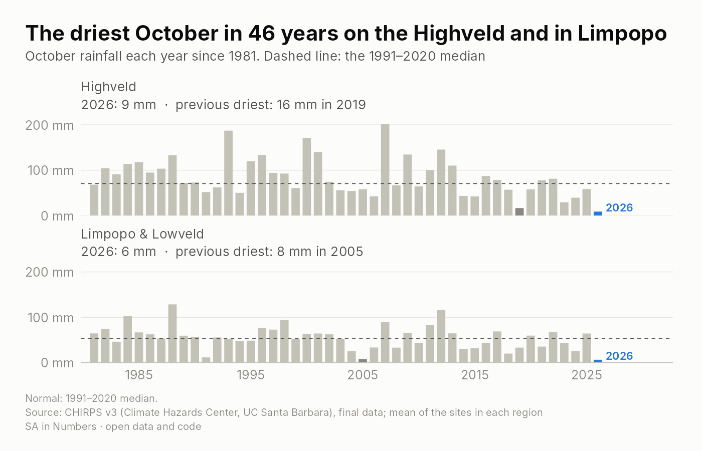
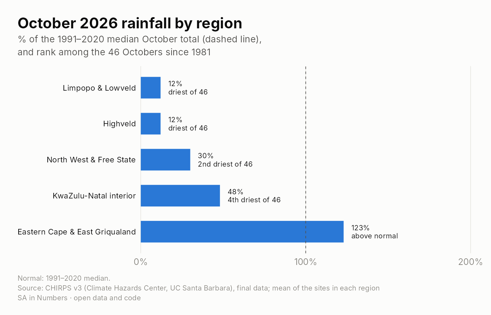

::: {.headline-grid}
::: {.stat}
::: {.value}
9 mm
:::
::: {.label}
Highveld, October 2026
:::
::: {.context}
12% of the 70 mm median; driest of 46
:::
:::

::: {.stat}
::: {.value}
6 mm
:::
::: {.label}
Limpopo & Lowveld, October 2026
:::
::: {.context}
12% of the 53 mm median; driest of 46
:::
:::

::: {.stat}
::: {.value}
30%
:::
::: {.label}
of normal in North West & Free State
:::
::: {.context}
2nd driest of 46
:::
:::

::: {.stat}
::: {.value}
123%
:::
::: {.label}
of normal in the Eastern Cape & East Griqualand
:::
::: {.context}
the one region above normal
:::
:::
:::

In October 2026, the Highveld (Gauteng, the Mpumalanga Highveld and the Vrede area) averaged 9 mm of rain, 12% of its 1991–2020 median of 70 mm. Limpopo & Lowveld averaged 6 mm, also 12% of its median (53 mm). For both regions, that is the lowest October total of the 46 since 1981.

The previous lows were 16 mm on the Highveld in October 2019, and 8 mm in Limpopo & Lowveld in October 2005. The Limpopo margin is small: 6.4 mm against 8.1 mm.

```{=html}
<figure class="figure story-chart">
<picture>
<source media="(max-width: 700px)" srcset="social/chart-october_square.png">

</picture>
</figure>
```

## The other regions

- **North West & Free State:** 15 mm, 30% of normal, the 2nd driest October since 1981. The driest was 2019, with 3 mm.
- **KwaZulu-Natal interior:** 41 mm, 48% of normal, the 4th driest.
- **Eastern Cape & East Griqualand:** 97 mm, 123% of normal.

```{=html}
<figure class="figure story-chart">
<picture>
<source media="(max-width: 700px)" srcset="social/chart-regions_square.png">

</picture>
</figure>
```

## Since October

In these three regions, October brings 8–13% of the October-to-April rain on average (1991–2020), and December to February just over half. By 15 November, storms had lifted the season so far to 77% of normal on the Highveld, 64% in Limpopo & Lowveld and 46% in North West & Free State. November figures are preliminary.

National dam storage was 93.5% on 16 November, against 91.7% a year earlier (Department of Water and Sanitation).

The [El Niño summer tracker](../../trackers/el-nino-2026/index.qmd) follows the rest of the season every Monday.

## What the data can't tell us

::: {.cant-tell}
- **The rain is estimated, not measured at every gauge.** CHIRPS blends satellite estimates with rain-gauge records on a 5 km grid. It is good at comparing one October with another, and weaker for exact local totals.
- **At totals this small, a few millimetres matter.** Limpopo & Lowveld's 6.4 mm against 8.1 mm in 2005 is within the likely estimation error, so another dataset could reverse that ranking. The Highveld margin (9 mm against 16 mm) is wider.
- **Each region is the average of 5 to 12 sites, not every farm.** Rain falls patchily, and some districts will have had more or less than this.
- **"In 46 years" means since 1981.** That is where CHIRPS begins. Longer station records may hold drier Octobers.
- **It does not say why.** El Niño raises the odds of a dry summer, but this analysis does not attribute October to it.
- **One dry month does not decide a season.** Just over half of the summer's rain normally falls from December to February.
:::

## Method

- **Data:** [CHIRPS v3](https://www.chc.ucsb.edu/data/chirps3) 5-day rainfall totals (Climate Hazards Center, UC Santa Barbara). All October 2026 values are final, not preliminary.
- **Sites and regions:** each site's value is the mean of a 0.25° window (about 25 km) around it; each region's value is the mean of its sites. The six regions and their sites are listed on the [El Niño tracker](../../trackers/el-nino-2026/index.qmd#regions-and-method), with the test that the sites in each region rise and fall together.
- **October total:** the sum from 1 to 31 October. **Normal:** the median of the 1991–2020 October totals. **Rank:** among the 46 Octobers 1981–2026.
- **Season so far** and **dams:** from the El Niño tracker's update of 22 November 2026.

**Download:** [this story's numbers](data.csv) (every region, every October since 1981)

**Code:** `stories/build_story_charts.R` in the project's [GitHub repository](https://github.com/steyntrade-cpu/sa-in-numbers). The numbers on this page are frozen as at the data of 22 November 2026.

## Update log

- 23 November 2026: published.
