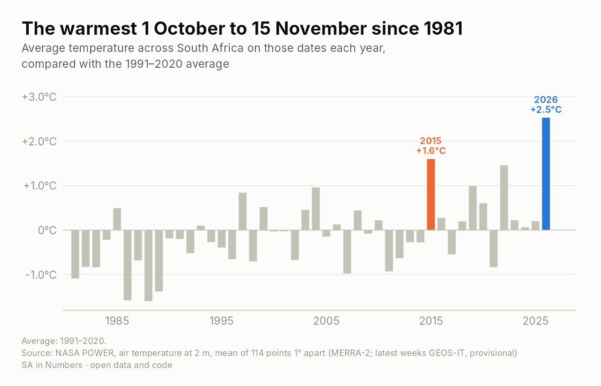
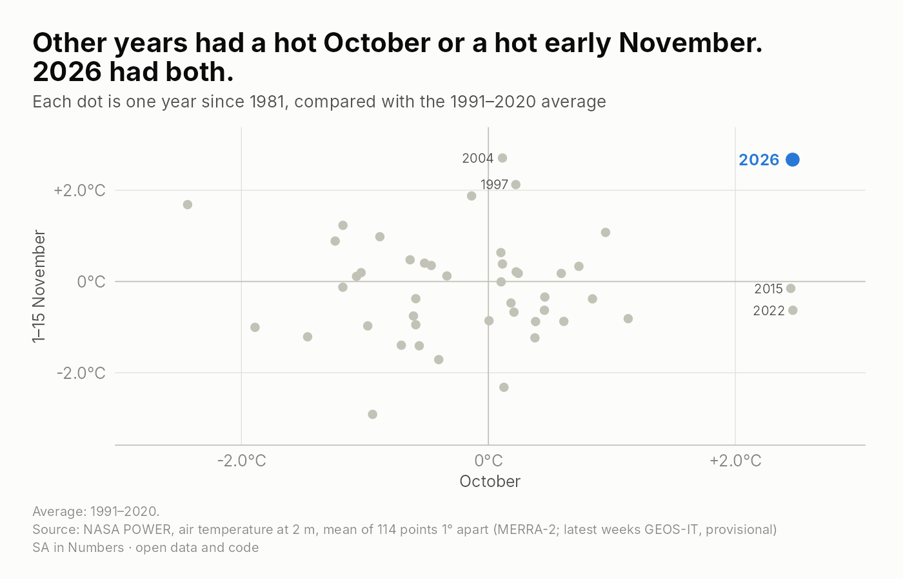

::: {.headline-grid}
::: {.stat}
::: {.value}
22.5 °C
:::
::: {.label}
average, 1 October to 15 November 2026
:::
::: {.context}
1991–2020 average: 19.9 °C
:::
:::

::: {.stat}
::: {.value}
+2.5 °C
:::
::: {.label}
above the 1991–2020 average
:::
::: {.context}
warmest of 46 years since 1981
:::
:::

::: {.stat}
::: {.value}
0.9 °C
:::
::: {.label}
warmer than the previous warmest
:::
::: {.context}
2015: +1.6 °C
:::
:::

::: {.stat}
::: {.value}
37 of 46
:::
::: {.label}
days warmer than average for the date
:::
::: {.context}
13 were the warmest for their date since 1981
:::
:::
:::

From 1 October to 15 November 2026, the average temperature across South Africa was 22.5 °C. That is 2.5 °C above the 1991–2020 average for those dates, and the highest of the 46 years since 1981. The previous highest was 2015, at 1.6 °C above average.

```{=html}
<figure class="figure story-chart">
<picture>
<source media="(max-width: 700px)" srcset="social/chart-years_square.png">

</picture>
</figure>
```

## Hot from start to finish

Split in two, neither half of the period was a record on its own:

- **October 2026** was 2.5 °C above average, level with October 2022 and October 2015. The three are within 0.02 °C of each other, which is a tie.
- **1 to 15 November 2026** was 2.7 °C above average, second to 2004. The two are 0.04 °C apart, also effectively a tie.

What no earlier year had was both. In 2015 and 2022, early November was near or below average. In 2004, October was close to average.

```{=html}
<figure class="figure story-chart">
<picture>
<source media="(max-width: 700px)" srcset="social/chart-both-halves_square.png">

</picture>
</figure>
```

On 37 of the 46 days, the national average was above the 1991–2020 average for that date. On 13 days it was the highest for that date since 1981. The day furthest above average was 16 October, at 6.6 °C above.

Follow the rest of the year on the [South Africa temperature tracker](../../trackers/sa-temperature/index.qmd).

## What the data can't tell us

::: {.cant-tell}
- **These are model values, not thermometer readings.** NASA POWER is a reanalysis: a weather model fitted to observations, about 50 km per grid cell. It is suited to comparing years with each other, not to exact local temperatures.
- **The latest weeks are provisional.** NASA fills recent weeks with a near-real-time model (GEOS-IT) and revises them later. The 0.9 °C margin over 2015 is much larger than the usual revisions, but the exact value may change.
- **"Since 1981" means since 1981.** That is where the data begin. Some weather stations have longer records; we make no claim about years before 1981.
- **A national average hides regional differences.** Some areas were hotter than this and some cooler.
- **It does not say why.** El Niño years and long-term warming both raise South African temperatures; this analysis does not separate them.
- **It does not forecast the rest of the summer.**
:::

## Method

- **Data:** daily mean air temperature at 2 m (T2M) from [NASA POWER](https://power.larc.nasa.gov/) at 114 points 1° apart covering South Africa (Lesotho and Eswatini excluded). The national value is the average of the points, weighted by the cosine of latitude, so that each point counts in proportion to the area it represents.
- **Each year:** the average of the daily national values from 1 October to 15 November. The 15 November cut-off matches the [October rain story](../2026-11-driest-october/index.qmd) and the ERA5 check below.
- **Average:** the mean of the 1991–2020 values for the same dates. **Rank:** among the 46 years 1981–2026.
- **Halves:** 1–31 October and 1–15 November, each compared with its own 1991–2020 average.
- **Days:** each day's national value compared with the 1991–2020 average for that calendar date, and with the highest value for that date in 1981–2025.
- **Cross-check (ERA5):** *result to be added after the check runs.* The same comparison is repeated in ECMWF's ERA5 reanalysis at 30 of the points (`tests/check_era5_temperature.R`).

**Download:** [this story's numbers](data.csv) · [daily national temperature since 1981](../../data/processed/sa_temperature_daily.csv)

**Code:** `stories/build_story_charts.R` in the project's [GitHub repository](https://github.com/steyntrade-cpu/sa-in-numbers). The numbers on this page are frozen as at the data of 22 November 2026.

## Update log

- 23 November 2026: published.
